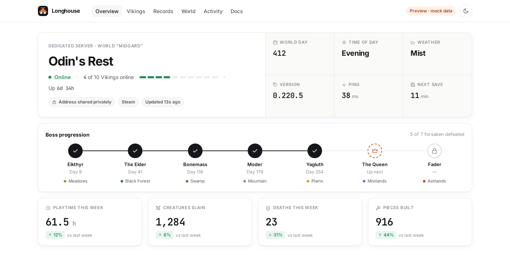
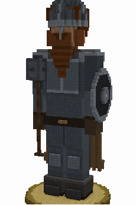
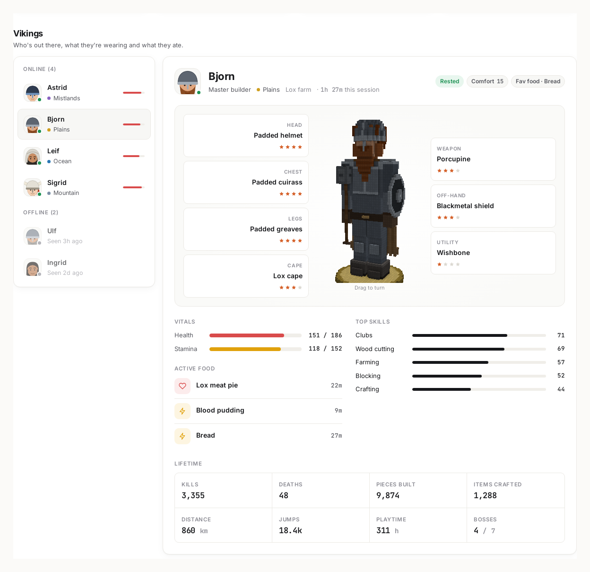
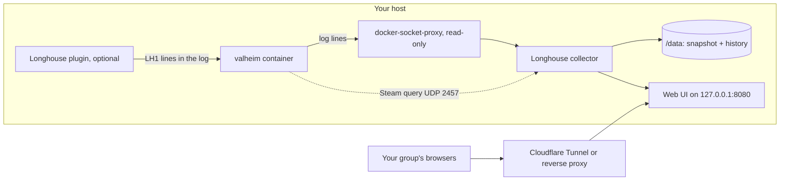

<p align="center">
  
</p>

<h1 align="center">Longhouse</h1>

<p align="center">
  A self-hosted web dashboard for your Valheim dedicated server.<br>
  Who's online, what day it is, who keeps dying, and every Viking as a 3D figure in their own gear.
</p>

<p align="center">
  <a href="https://mrguato.github.io/valheim-game-dashboard/"><b>Live demo</b></a> ·
  <a href="https://mrguato.github.io/valheim-game-dashboard/docs.html"><b>Docs</b></a> ·
  <a href="https://github.com/MrGuato/valheim-game-dashboard/pkgs/container/valheim-game-dashboard"><b>Container image</b></a> ·
  <a href="https://github.com/MrGuato/valheim-game-dashboard/releases"><b>Releases</b></a> ·
  <a href="https://github.com/MrGuato/valheim-game-server"><b>Valheim server</b></a>
</p>

<p align="center">
  <a href="https://github.com/MrGuato/valheim-game-dashboard/releases"></a>
  <a href="https://github.com/MrGuato/valheim-game-dashboard/actions/workflows/build.yml"></a>
  <a href="https://github.com/MrGuato/valheim-game-dashboard/actions/workflows/lint.yml"></a>
  <a href="https://github.com/MrGuato/valheim-game-dashboard/actions/workflows/security.yml"></a>
  <a href="https://github.com/MrGuato/valheim-game-dashboard/actions/workflows/codeql.yml"></a>
  <a href="LICENSE"></a>
  <a href="https://github.com/MrGuato/valheim-game-dashboard/commits/main"></a>
  <a href="https://github.com/MrGuato/valheim-game-dashboard/pkgs/container/valheim-game-dashboard"></a>
  <a href="https://github.com/MrGuato/valheim-game-dashboard"></a>
</p>

<p align="center">
  <a href="https://mrguato.github.io/valheim-game-dashboard/"></a>
</p>

---

```bash
git clone https://github.com/MrGuato/valheim-game-dashboard.git
cd valheim-game-dashboard/deploy
cp .env.example .env     # set VALHEIM_CONTAINER to your server's container name
docker compose up -d
```

Open `http://127.0.0.1:8080`. That's it. Put a Cloudflare Tunnel (or any reverse proxy) in front when you want your group to see it from home.

## Why this one

I run a Valheim world for family and friends, and the question in our group chat was always the same: "who's on?" Then it was "what day is it?", then "how did Bjorn die *again*?". Longhouse is the page that answers all of it. It runs next to the server every day, and every feature below is there because somebody in my group asked for it.

**See your world at a glance**
- Server status from Steam's own query: online, players, uptime, game version and ping.
- The in-game day and time of day, plus a countdown to the next world save.
- Boss progression across all seven forsaken, with the in-game day each one fell.
- This week's playtime, kills, deaths and pieces built, compared with last week.

**Every Viking gets a profile**
- Armory-style profiles with a **3D voxel figure** in the middle that wears their real hair, beard, armor, cape, weapon and shield. Drag it to turn it around.
- Gear slots around the figure, plus health, biome and where they were last seen.
- Kills per creature and pieces still standing, counted on the server.
- Leaderboards for deaths, playtime, longest session and sessions, and a "when do we play" heatmap.

<p align="center">
  
  &nbsp;&nbsp;
  
</p>

**Safe by default**
- Nothing on players' PCs. The optional plugin goes on the server only, so nobody's Steam achievements are affected.
- It reads the server log through a read-only Docker socket proxy. It never writes to your world files and never gets the Docker socket itself.
- It listens on `127.0.0.1` only. The way in is a tunnel you control, with an optional password on top.
- Steam IDs are hashed before anything is stored, and the server address stays hidden unless you choose to show it.
- It has no npm dependencies and no build step. The image is Node 24 LTS on Alpine, runs as an unprivileged user, and is scanned by CodeQL, gitleaks and Trivy on every change.

### Compared with the usual options

|                                   | Longhouse | Reading the server log | Host control panel |
| --------------------------------- | :-------: | :--------------------: | :----------------: |
| Who's online right now            | ✅ | if you're watching | ✅ |
| Shareable page for the whole group | ✅ | ❌ | usually admins only |
| In-game day, bosses, weekly stats | ✅ | by hand | ❌ |
| Player profiles with gear         | ✅ 3D figures | ❌ | ❌ |
| Deaths, playtime and leaderboards | ✅ | by hand | ❌ |
| Activity heatmap and feed         | ✅ | ❌ | ❌ |
| Needs mods on players' PCs        | ❌ never | ❌ | ❌ |
| Runs on your own hardware         | ✅ | ✅ | depends |

## Pair it with valheim-game-server

Longhouse works with any Valheim server that runs in Docker. It's built alongside my own [**valheim-game-server**](https://github.com/MrGuato/valheim-game-server), and the two fit together:

- Point `VALHEIM_CONTAINER` at the server container and Longhouse follows its log. Nothing else to configure for the vanilla stats.
- Set `BEPINEX=true` on the server and drop the [Longhouse server plugin](mods/README.md) into `config/bepinex/plugins/`. That adds the figures, gear, biomes, health, kills per creature and pieces built.
- Watchtower on the server host keeps Longhouse current too (the compose file already carries the label).

The server repo has a [setup page](https://mrguato.github.io/valheim-game-server/dashboard.html) for running the two together.

## What the plugin adds

| Shows on the dashboard                        | Without the plugin | With the plugin |
| --------------------------------------------- | :----------------: | :-------------: |
| Status, players, version, uptime              | ✅ | ✅ |
| Sessions, playtime, deaths, raids, heatmap    | ✅ | ✅ |
| In-game day and boss progress                 | ✅ | ✅ |
| 3D figure with real look and gear             | grey figure | ✅ |
| Biome, health                                 | ❌ | ✅ |
| Kills per creature, pieces standing           | ❌ | ✅ |

Skills, food and lifetime totals live only on each player's PC, so Longhouse doesn't show them for real players (the demo has them to show the layout).

## How it fits together



## Configuration

Everything lives in `deploy/.env`:

| Variable | What it does |
| -------- | ------------ |
| `VALHEIM_CONTAINER` | Name of the Valheim container to follow (default `valheim`) |
| `VALHEIM_QUERY_PORT` | Steam query port of the server (default `2457`) |
| `VALHEIM_MAX_PLAYERS` | Player slots shown in the status bar |
| `LONGHOUSE_SERVER_NAME` | Display name; empty uses the name the server reports |
| `LONGHOUSE_TIMEZONE` | Time zone for the heatmap and "when do we play" |
| `LONGHOUSE_BOSSES` | Bosses your group has beaten, e.g. `eikthyr,elder,bonemass` |
| `LONGHOUSE_PASSWORD` | Optional password for the whole page (HTTP basic auth) |
| `LONGHOUSE_HIDDEN_PLAYERS` | Comma-separated names to leave off the dashboard |
| `LONGHOUSE_BIND` | Where it listens on the host (default `127.0.0.1:8080`) |
| `TUNNEL_TOKEN` | Only with `docker compose --profile tunnel up -d`, to run cloudflared alongside |

The [docs](https://mrguato.github.io/valheim-game-dashboard/docs.html) cover the tunnel setup, Cloudflare Access and every other setting.

## Requirements

| Component | Minimum |
| --------- | ------- |
| Valheim server | Running in Docker on the same host (tested on Valheim 1.0.20) |
| Docker | 24.x or newer, with Compose v2 |
| CPU and RAM | Next to nothing: about 25 MB of RAM in practice |
| Architecture | amd64 or arm64 |
| Network | Nothing port-forwarded. A tunnel or reverse proxy if you want it public |

## What's in the repo

```
valheim-game-dashboard/
+-- index.html             The dashboard (also the GitHub Pages demo with mock data)
+-- docs.html              Documentation page
+-- assets/
|   +-- dashboard.js       Renders the snapshot
|   +-- figure.js          Flat SVG figures (portraits and fallback)
|   +-- voxel.js           3D voxel figures, plain WebGL with no libraries
|   +-- mock-data.js       Made-up players for the demo
+-- server/                Collector: log follower, Steam query, state, HTTP server
+-- mods/                  Longhouse server plugin (BepInEx, server-only)
+-- deploy/                docker-compose.yml + .env.example
+-- Dockerfile             Node 24 LTS on Alpine, non-root
+-- .github/workflows/     Build and publish, lint, security scans, CodeQL, Pages
```

No server addresses, passwords or real player data live in this repo. The demo uses made-up Vikings.

## Development

There's no build step and there are no npm dependencies.

```bash
python3 -m http.server 5178                                          # UI with mock data
VALHEIM_LOG_PATH=./valheim.log LONGHOUSE_DATA_DIR=./data npm start   # collector against a log file
npm test
```

## Releases and versioning

`latest` follows `main`. Tagged releases (`0.2.0`, `0.2`) stay put, so set `LONGHOUSE_TAG=0.2.0` in `.env` to pin one. What changed in each release is in the [CHANGELOG](CHANGELOG.md) and on the [releases page](https://github.com/MrGuato/valheim-game-dashboard/releases).

## Contributing and security

Issues and pull requests are welcome. For a security problem, please follow [SECURITY.md](SECURITY.md) instead of opening a public issue.

## License

[MIT](LICENSE). Valheim is a trademark of Iron Gate AB. This project isn't affiliated with Iron Gate or Coffee Stain. The character figures are original voxel art built from appearance and gear data; no game models or textures are used or redistributed.

Skål, and see you in the longhouse!
